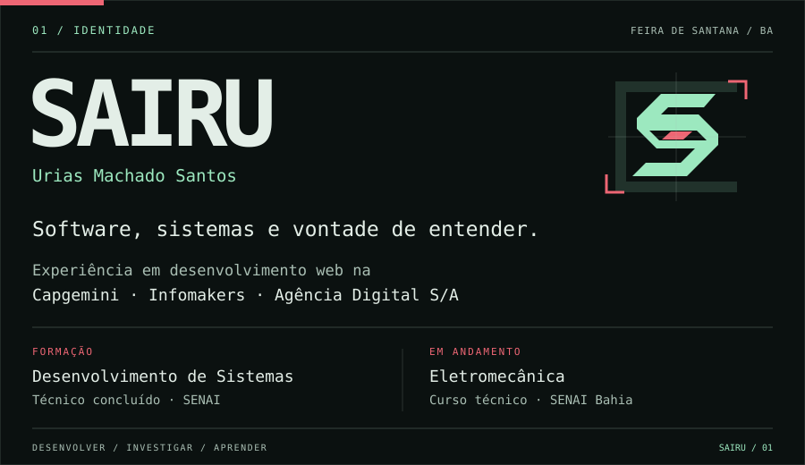
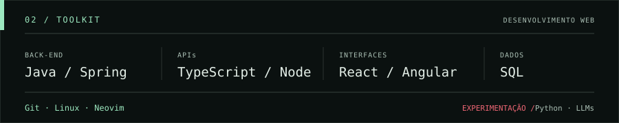

  

  

  <a href="https://saiiru.github.io/">Portfólio</a> ·
  <a href="https://www.linkedin.com/in/sairu/">LinkedIn</a> ·
  <a href="https://github.com/Saiiru">GitHub</a>

Bio e tecnologias em texto

Sou **Urias Machado Santos — Sairu**, desenvolvedor de software em Feira de Santana, Bahia. Tenho experiência com desenvolvimento web na **Capgemini, Infomakers e Agência Digital S/A**.

Concluí o curso técnico em **Desenvolvimento de Sistemas** e hoje curso **Eletromecânica no SENAI Bahia**.

- **Desenvolvimento:** Java / Spring, TypeScript / Node.js, React / Angular e SQL.
- **Ferramentas:** Git, Linux e Neovim.
- **Experimentação:** Python e modelos de linguagem.

