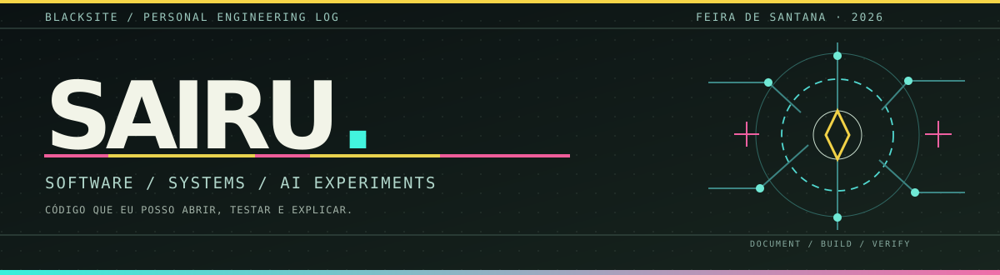

  

  <a href="https://saiiru.github.io/">Portfólio</a> ·
  <a href="PROJECTS.md">Todos os projetos</a> ·
  <a href="https://github.com/Saiiru/saiiru.github.io">BLACKSITE e laboratórios</a> ·
  <a href="https://www.linkedin.com/in/sairu/">LinkedIn</a> ·
  <a href="mailto:sairufsa@gmail.com">Contato</a>

### Ei, eu sou Urias. Na internet, quase sempre Sairu.

Desenvolvo software e gosto de entender o problema antes de escolher a ferramenta. Passei por equipes de desenvolvimento na **Capgemini, Infomakers e Agência Digital S/A**, trabalhando com aplicações web, integração e investigação de falhas.

Hoje curso **Técnico em Eletromecânica no SENAI Bahia**. Isso fez a minha curiosidade ir além das APIs: sensores, circuitos, interfaces embarcadas e sistemas que precisam funcionar fora do editor de código. Os meus experimentos com IA nasceram dessa mesma vontade de testar as coisas até entender como funcionam.

Não quero que um projeto pareça maior do que realmente é. Aqui você encontra **código profissional que posso descrever, projetos educacionais, laboratórios pessoais e forks identificados**.

## Comece por estes projetos

| Projeto | O que ele demonstra | Estado |
| :--- | :--- | :--- |
| [**BLACKSITE / AI Builder Labs**](https://github.com/Saiiru/saiiru.github.io) | Três ferramentas testáveis: avaliação de respostas, triagem com aprovação humana e busca em documentos com fontes. | Protótipos demonstráveis; não são serviços de produção. |
| [**Ada Commerce**](https://github.com/Saiiru/ada-commerce) | Java, domínio de e-commerce, separação de camadas e testes com JUnit. | Projeto educacional aberto. |
| [**Plann.er API**](https://github.com/Saiiru/Plann.er) | API de planejamento de viagens com TypeScript, Fastify e persistência. | Projeto de estudo aberto. |
| [**my_dotfiles**](https://github.com/Saiiru/my_dotfiles) | Ambiente Arch/Hyprland/Quickshell, configuração e documentação de ferramentas. | Ambiente pessoal em evolução. |
| [**FullStack13Go**](https://github.com/Saiiru/FullStack13Go) | Estudos e desenvolvimento em Go. | Repositório de aprendizado. |

**[Abrir o catálogo completo dos 62 repositórios públicos](PROJECTS.md)** — incluindo **28 próprios e 34 forks de outros autores** na captura de novembro de 2026.

## O que estou investigando agora

**IA que pode ser verificada.** Em vez de uma lista de prompts, quero testar entradas, saídas, critérios e fontes. No BLACKSITE há três experimentos:

- **EvalForge:** quando uma resposta está errada, qual critério falhou?
- **OpsPilot:** como sugerir uma decisão sem retirar a aprovação humana?
- **DocTrace:** de onde veio cada informação da resposta?

O modo público padrão é determinístico e usa dados de exemplo; não afirmo que as regras são inferência por um LLM. Existe um caminho opcional para testar um provedor de modelos localmente, com configuração de chave fora do navegador.

<strong>Ferramentas que uso ou estudo</strong>

**Software:** Java, Spring Boot, JavaScript/TypeScript, Node.js, React, Angular, SQL e Git.

**Sistemas:** Arch Linux, shell, Neovim, documentação de ambiente e manutenção de aplicações.

**Laboratórios:** Python em estudos, modelos de linguagem, recuperação de documentos, ESP32, SPI e instrumentação básica.

Não são certificações, notas de proficiência nem alegação de uso empresarial de todas essas tecnologias.

<strong>Como eu documento um projeto?</strong>

Procuro apresentar **problema → decisão → implementação → evidências → limitações**. Testes e código devem ser reproduzíveis. Se uma demo depende de um serviço externo, isso precisa estar explícito; se é apenas um laboratório, também.

## Formação e experiência

| Período | Experiência ou formação |
| :--- | :--- |
| 2021–2022 | Agência Digital S/A — desenvolvimento full stack |
| 2022 | Infomakers — desenvolvimento front-end |
| 2022–2023 | Capgemini — desenvolvimento de software / análise de soluções |
| Concluído em 2022 | Técnico em Desenvolvimento de Sistemas — SENAI |
| Desde agosto de 2026 | Técnico em Eletromecânica — SENAI, em andamento |

---

**[Ver projetos](PROJECTS.md)** · **[Explorar o BLACKSITE](https://github.com/Saiiru/saiiru.github.io)** · **[Conversar por e-mail](mailto:sairufsa@gmail.com)**

Feira de Santana, Bahia · os melhores bugs são aqueles que ensinam alguma coisa.
