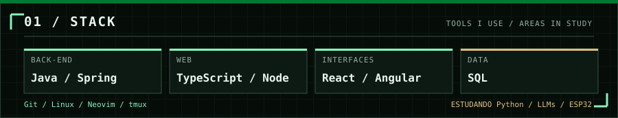
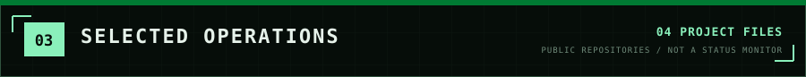
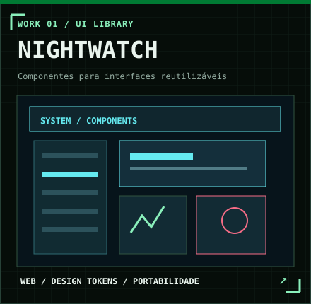
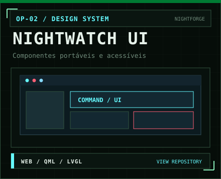
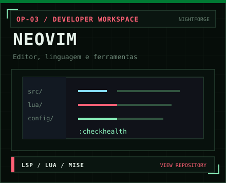
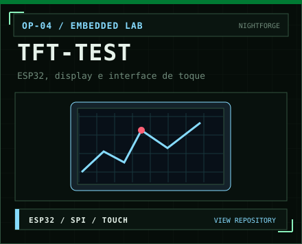
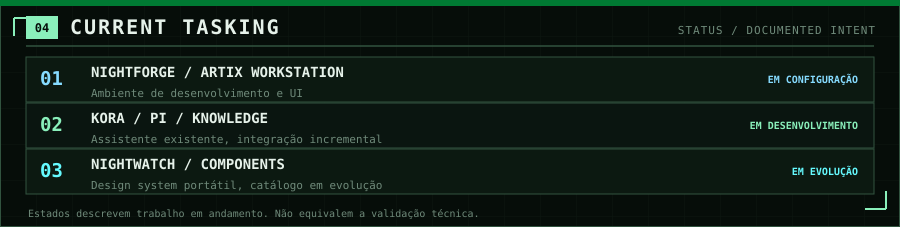
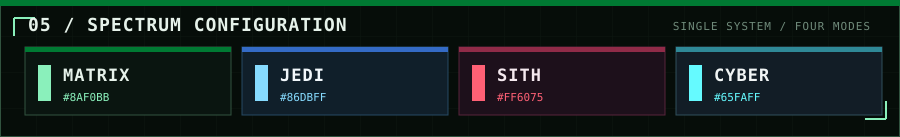

  

  

  

  
  

  
  

  

  

  <a href="https://saiiru.github.io/">Portfólio</a> ·
  <a href="https://www.linkedin.com/in/sairu/">LinkedIn</a> ·
  <a href="https://github.com/Saiiru/nightwatch-ui">Nightwatch UI</a> ·
  <a href="THEMES.md">Paletas e tokens</a>

<!-- SVGs autorais. Estrutura inspirada pelos painéis técnicos de https://github.com/mille-okws/mille-okws, sem copiar os arquivos da autora. -->
