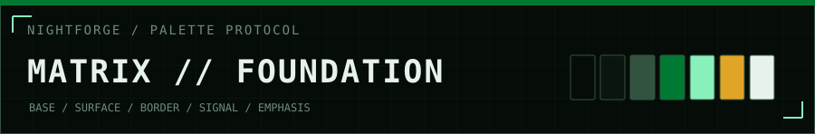
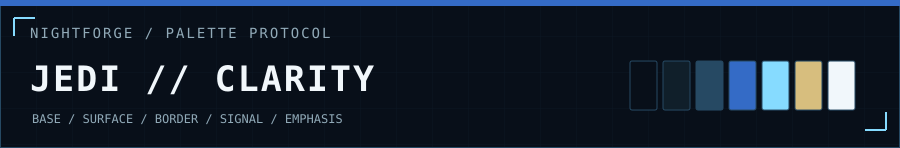
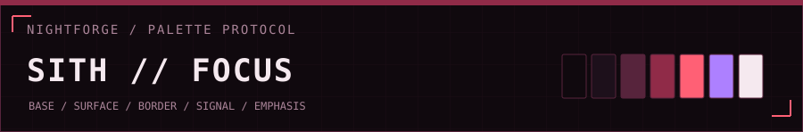
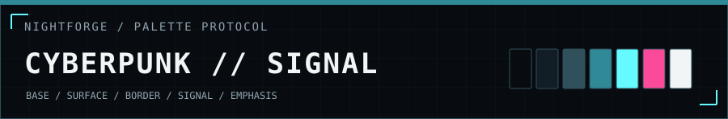

# NIGHTFORGE — Matrix, Jedi, Sith e Cyberpunk

Um sistema de interface, quatro modos visuais. O perfil usa **Matrix** como padrão e preserva as outras três paletas em tokens sem duplicar componentes. A intenção é reutilizar a semântica em interfaces web, Quickshell/QML, LVGL e painéis de engenharia, adaptando as APIs de cada plataforma.

## Matrix / baseline


## Jedi / clarity


## Sith / focus


## Cyberpunk / signal


## Tokens

Os arquivos [`themes/tokens.css`](themes/tokens.css) e [`themes/palettes.json`](themes/palettes.json) são a fonte de valores reutilizáveis.

```html
<section data-nf-theme="sith">
  <!-- Um componente pode consultar var(--nf-accent), sem CSS global adicional. -->
</section>
```

A paleta Matrix usa os valores observados nos SVGs do perfil mille-okws; os demais modos são adaptações autorais. **Não** são paletas oficiais de Star Wars, Watch Dogs ou Cyberpunk 2077.

Para integrar ao [Nightwatch UI](https://github.com/Saiiru/nightwatch-ui), mapear tokens semanticamente antes de alterar a aplicação: `--nf-bg` → `--nw-bg`, `--nf-accent` → `--nw-accent` etc. Não substituir automaticamente os tokens da biblioteca.

Design: estrutura de dossiê/telemetria, grid técnico, contraste, hierarquia e cores funcionais. Tema não altera estado real do software. Sem telemetria fictícia apresentada como real.
